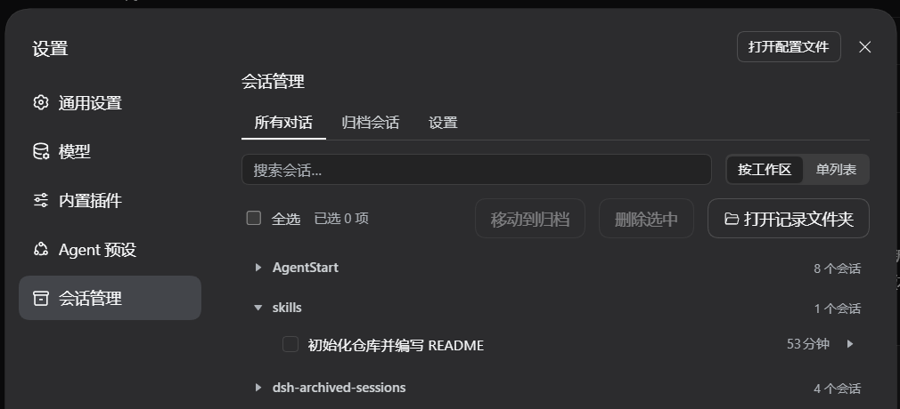
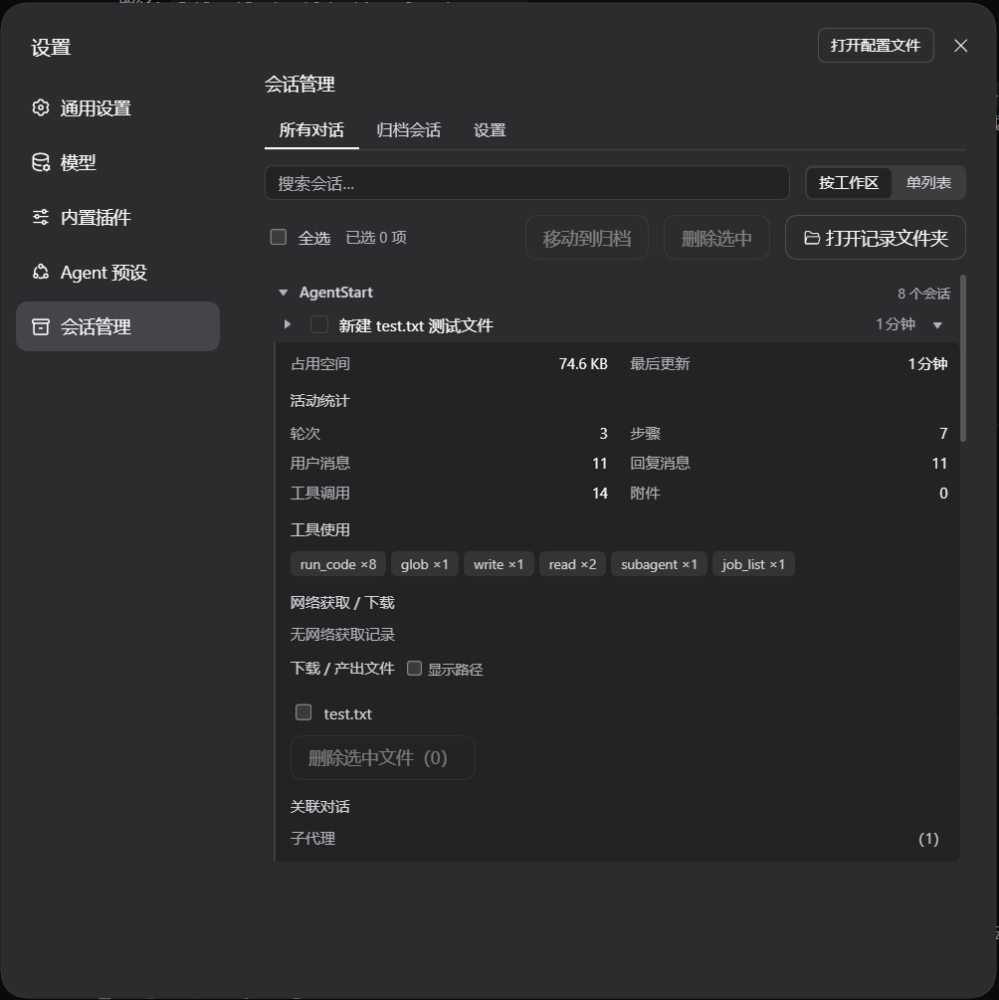
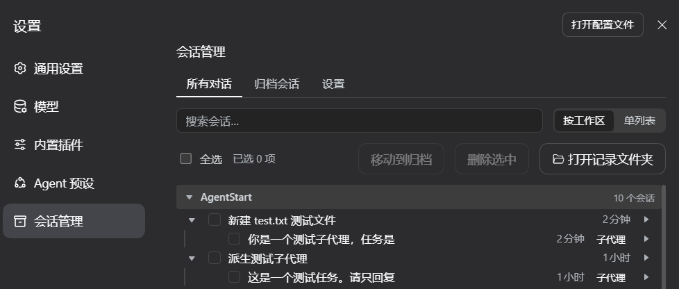
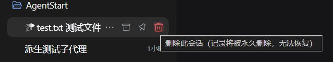
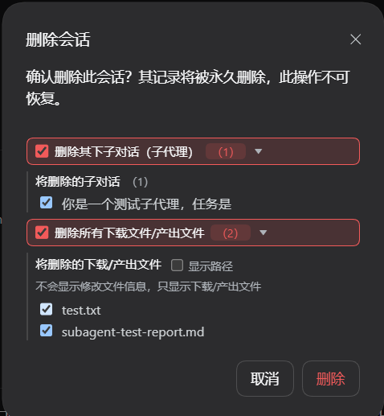
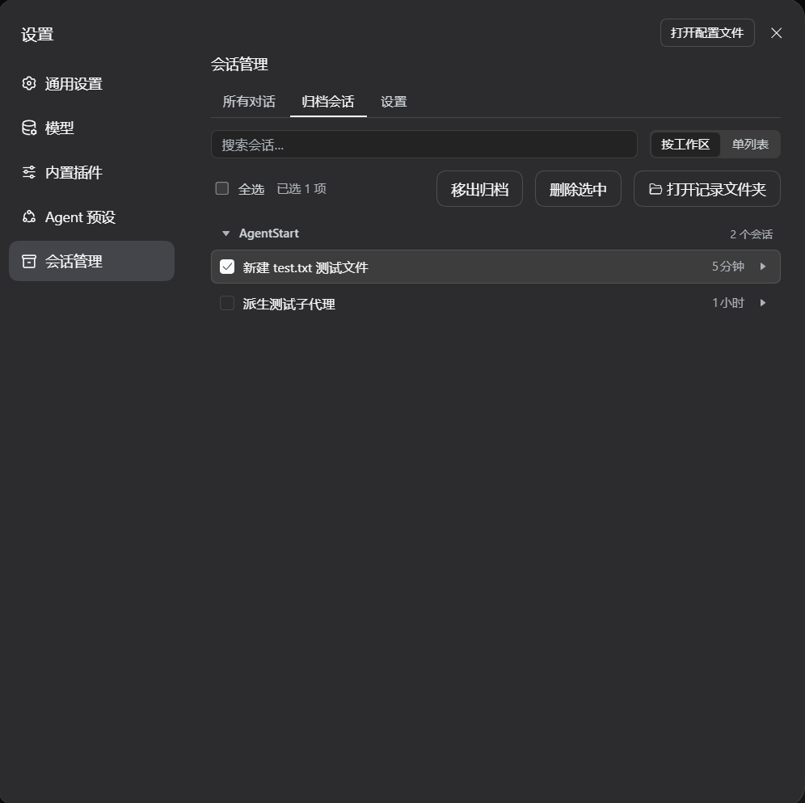
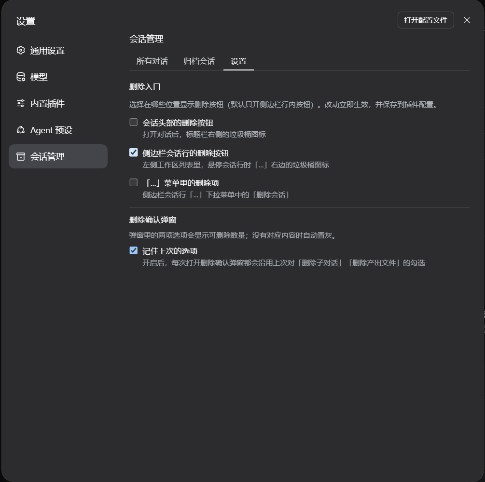

# dsh-archived-sessions（DSH 会话管理）

<div align="center">

[中文](#中文) | [English](#english)

</div>

## 中文

一个 DSH Web 插件：在「设置」中提供**会话管理**，统一管理本机上的所有对话。

> **Fork 声明**：本仓库是 [Zephyr-vibe/dsh-archived-sessions](https://github.com/Zephyr-vibe/dsh-archived-sessions) 的 **fork**，由 **AkotaP** 二次开发并维护（上游作者 Zephyr-vibe）；**本 fork 的仓库是 [AkotaP/dsh-archived-sessions](https://github.com/AkotaP/dsh-archived-sessions)**，安装与反馈都以它为准；版本号自 **0.2.0** 起与上游分开编号（上游最后发布的是 0.1.5）。上游的 MIT 许可与版权声明原样保留在 [LICENSE](LICENSE) 中；本 fork 的改动全部列在 [CHANGELOG.md](CHANGELOG.md)。
>
> 相对上游的主要改动：适配 **DSH 0.2.1-rc.2**（读取原语、0.2.x 当前会话识别、图标改名、slot 变化）· 三处删除入口（标题栏 / 侧边栏「…」右边 / 「…」菜单里）与**独立开关**（走官方 settings 文档）· 分组视图可折叠 + **工作区横幅全选** · 删除链路安全校验与孤儿引用清理 · 删除弹窗的**子对话默认勾选 / 红色警示语义 / 置灰记忆** · 详情批量读取与详情卡缩进对齐 · 离线测试套件（49 条）。

[English](#english)

### 功能

- **双标签页**：**所有对话**（未归档）与**归档会话**
- **视图切换**：**单列表**或**按工作区分组**（无工作区归属的会话兜底归入「未分组」）；分组视图里**点工作区标题即可折叠/展开**该组（标题前有三角指示、带 aria-expanded），「所有对话」与「归档会话」两个标签页都支持
- **工作区横幅全选**：分组视图里每个工作区标题内有一个「☐ 全选」复选框开关，一次全选/取消该组全部会话（折叠组也算）；计数固定宽度，不会影响开关对齐
- 按标题 + 相对时间浏览对话，最近的排在最前
- **搜索框**：按标题或 ID 实时过滤会话列表（「所有对话」与「归档会话」两个列表页都可用）
- 勾选 / **按住左键在会话行上滑动批量勾选**（按下那一行的状态决定方向：没勾＝连续加选，已勾＝连续取消；滑过的行跟着变，松开左键结束）/ 全选 / 批量**归档**（记录保留）/ 批量**删除**（永久删除，带确认弹窗）
- **三处「删除会话」入口**（0.1.7 适配）：官方在 0.1.7 重新开放了侧边栏行菜单（⋮）的插件注入点，因此删除入口有三处——**打开的会话标题栏**（🗑 垃圾桶图标）、**侧边栏会话行「…」右边的悬停按钮**、**侧边栏会话行「…」菜单里的「删除会话」项**；三处共用同一个细粒度确认弹窗，可勾选删除其下**子对话 / 下载·产出文件 / 整个文件夹**，默认勾选子对话（避免孤儿）、不勾选产出文件，可在弹窗里取消。后两处与标题栏是否显示可在「会话管理 → 设置」里分别开关（默认只开「…」右边的悬停按钮）
- **删除确认弹窗的两项选项**：删除其下**子对话（子代理）**与**下载/产出文件**各自带一个可删数量徽标；**未开“记住上次选项”时子对话默认勾选**。红色只表示风险——**有子对话但未勾选**时整行转红并提示“会保留为孤儿子会话”，勾选状态不再染红（子对话复选框用强调色，文件保持原来的红色）。某项没有可删内容时整行置灰、复选框禁用，但仍显示上次的勾选状态（悬停说明「没有可删除的内容」）。开启「会话管理 → 设置 → 删除确认弹窗 → 记住上次的选项」后，每次打开弹窗都沿用上次对这两项的勾选
- 归档页支持**移出归档**（回到所有对话）
- **打开记录文件夹**按钮：在系统文件管理器中打开所选会话的记录目录，跨平台（`explorer` / `open` / `xdg-open`）
- 每行可展开详情（默认收起）：占用空间、最后更新、活动统计（轮次、步骤、消息数、工具调用分布、fetch 记录）、产出/下载文件、父会话与子会话（分叉）
- **子代理会话**嵌套显示在父会话下方（逐级缩进 + 左侧引导线 + 「子代理」徽标；父行永远与同级对齐，展开按钮不会把自己顶成「子对话」）；父会话被归档/过滤/删除而缺失时自动浮出为顶层行，并说明原因
- **删除父会话不会级联**：子代理、分叉、下载/产出文件均保留，除非你显式勾选它们——避免误删
- 当前打开的会话显示「当前会话」徽标，且**不可删除**

### 截图

<div align="center">
  
  <p>① 列表：按工作区分组，点工作区标题即可折叠 / 展开该组（标题前有三角指示）</p>
</div>

<div align="center">
  
  <p>② 详情：展开某一行，查看占用空间、活动统计、产出文件与关联对话</p>
</div>

<div align="center">
  
  <p>③ 子代理：子对话嵌套在父会话下（逐级缩进 + 左侧引导线 + 「子代理」徽标）</p>
</div>

<div align="center">
  
  <p>④ 删除入口：侧边栏会话行「…」右边的删除按钮（悬停提示：删除此会话——记录将被永久删除，无法恢复）</p>
  <br />
  
  <p>⑤ 删除确认弹窗——可勾选删除其下子对话 / 下载·产出文件 / 整个文件夹</p>
</div>

<div align="center">
  
  <p>⑥ 归档：归档会话标签页，勾选后点「移出归档」即可放回「所有对话」</p>
</div>

<div align="center">
  
  <p>⑦ 设置：三个删除入口开关 + 删除确认弹窗的「记住上次的选项」</p>
</div>

### 安装

#### 方式一：直接 tarball 安装

```sh
dsh plugin --profile web add https://codeload.github.com/AkotaP/dsh-archived-sessions/tar.gz/refs/heads/main
```

如果 pnpm 拦截构建脚本，在命令末尾加 `--ignore-scripts`：

```sh
dsh plugin --profile web add https://codeload.github.com/AkotaP/dsh-archived-sessions/tar.gz/refs/heads/main --ignore-scripts
```

#### 方式二：让 agent 安装

告诉你的 DSH 智能体：

```text
帮我把这个项目安装为插件：https://github.com/AkotaP/dsh-archived-sessions
```

agent 会下载项目、放入 profile 的 `node_modules` 并注册到 `dsh.profile.bundles`。

安装后重启 web 端，即可在「设置」中看到「会话管理」入口。

### 兼容性

- **零配置**：会话目录按官方 DSH 布局（`$DSH_HOME/sessions/<project-key>/<session-id>/`）自动识别，无需核心补丁
- **归档 / 恢复**：基于官方 `archiveSession` 相同的 `registry` 状态原语实现
- **删除不级联**：只删除所选会话，子代理、分叉与文件均保留；运行中的会话拒绝删除（409）
- **API 仅信任本机请求**（127.0.0.1 / localhost / ::1）；仅使用官方公开 API（`workspaceRegistry`、`sessionPersistence`、`sessionQuery`）
- **核心版本**：面向 **DSH 0.2.1-rc.2**（在 0.2.1-rc.2 运行版与 0.2.1-rc.3 源码上核对；0.1.7+ 的读取/归档回退仍保留）

### 开发与测试

```bash
pnpm install          # 依赖（宿主半边必须自带：@deepseek-ai/schemastery）
pnpm test             # 等价于在仓库根跑 node --test；不需要 DSH，也不需要浏览器
```

> 测试脚本就是 `node --test`（自动发现 `test/**/*.test.mjs`）。`test/support/harness.mjs` 也会被当成一个空测试文件跑一遍，属正常现象。

测试用"桩模块图 + 迷你 React"直接跑构建产物（`lib/index.js` / `lib/client.js`），当前共 **49** 条，覆盖三类契约：

- **界面契约**：五个 slot 的名字/order/id、菜单项结构（危险色 + 分隔线，且菜单树里没有弹窗）、点选→`shell.overlay` 弹窗→`POST /archived/api/delete`、分组折叠与横幅全选、弹窗默认值/红色语义/置灰记忆、当前会话识别、分组搜索、详情卡缩进、批量扫描与旧宿主回退、fresh install 默认值、样式规则与"条目 id 与 `cordis.patch.yml` 一致"
- **配置通道**：宿主 `Config` 四字段 `volatile`、`volatileForm`/`isVolatilePath` 能投影与写入、客户端 `configForms` 读取/写入/失败提示（绿字闪一下、红字常驻）、ui-settings 晚到时通过 `ctx.inject` 绑定
- **host API**：运行中会话与运行中子代理 409、只允许 loopback（含 socket 地址）、非法 `subagentIds`/`filePaths` 被拒、非 jsonl 后端 501、真实临时目录文件删除白名单、`details-batch` 批量读取、活跃归档 409、已下线的私有 config 接口保持 404

改动后至少保证 `pnpm test` 全绿再提交。

### 更新日志

版本变更记录已独立到 [CHANGELOG.md](CHANGELOG.md)（含 0.3.0 起的中英双语条目；历史版本记录已迁入）。

### 许可证

MIT — © 2026 Zephyr-vibe

---

## English

A DSH web plugin: a **Session Manager** in Settings — manage every conversation on this machine in one place.

> **Fork notice**: this repository is a **fork** of [Zephyr-vibe/dsh-archived-sessions](https://github.com/Zephyr-vibe/dsh-archived-sessions), further developed and maintained by **AkotaP** (original work by Zephyr-vibe) — **this fork lives at [AkotaP/dsh-archived-sessions](https://github.com/AkotaP/dsh-archived-sessions)**, which is the canonical source for installing it and filing issues; versioning diverges from upstream at **0.2.0** (upstream last shipped 0.1.5). The upstream MIT license and copyright notice are kept verbatim in [LICENSE](LICENSE); every change made by this fork is listed in [CHANGELOG.md](CHANGELOG.md).
>
> Main differences from upstream: adapted to **DSH 0.2.1-rc.2** (read primitives, 0.2.x current-Session detection, renamed icon exports, new slots) · three delete entry points (title bar / right of the sidebar "…" / inside the "…" menu) with **independent switches** backed by the official settings document · collapsible workspace grouping + **workspace-banner select-all** · deletion validation and orphan-reference pruning · delete-dialog **default-checked sub-conversations / new red-warning semantics / greyed last-choice display** · bulk detail reads and aligned detail cards · an offline test suite (49 tests).

[中文](#中文)

### Features

- **Two tabs**: **All conversations** (non-archived) and **Archived**
- **View modes**: **flat list** or **grouped by workspace** (sessions without a workspace fall back to "Ungrouped"); in the grouped view **clicking a workspace heading collapses/expands that group** (a disclosure triangle plus aria-expanded), and both the All conversations and Archived tabs support it
- **Workspace banner select-all**: each workspace heading carries a "☐ Select all" checkbox toggle that selects/clears the whole group (collapsed members included); the count column has a fixed width so the toggle never shifts
- Browse conversations by title + relative time, newest first
- **Search box**: filter the session list by title or id in real time (available on both list tabs)
- Checkbox / **press-and-drag multi-select** (holding the left button on a row picks the direction — "add" when that row was unchecked, "remove" when it was checked — and every row you slide over follows it; releasing the button ends the gesture) / select-all / batch **archive** (records kept) / batch **delete** (permanent, with a confirmation modal)
- **Three "Delete session" entry points** (0.1.7 adaptation): 0.1.7 reopened the sidebar row menu (⋮) to plugins, so there are now three — the **opened session's title bar** (🗑 trash icon), the **hover button right of a sidebar row's "…" trigger**, and a **"Delete session" row inside that "…" menu**; all three share one fine-grained confirmation dialog that lets you optionally delete this session's **sub-conversations / downloaded·produced files / whole folders**, with sub-conversations checked by default (to avoid orphans) and produced files unchecked; both can be changed in the dialog. The latter two, and the title-bar button, can each be switched off under Session manager → Settings (only the "…"-right hover button starts on)
- **The two delete-dialog options** — sub-conversations (subagents) and downloaded/produced files — each carry a count badge; **sub-conversations are checked by default when the "remember" switch is off**. Red now marks risk only: **sub-conversations exist but are unchecked**, with a hint that they will remain as orphan subagent sessions. Checking no longer turns red (the subagent checkbox uses the accent colour, the file checkbox keeps its original red). An option with nothing to delete is greyed out and disabled but still shows the last choice (hover explains "nothing to delete"). With Settings → Delete confirmation dialog → "Remember the last choice" on, every dialog reuses your last selections
- **Unarchive** from the Archived tab (move back to All conversations)
- **Open record folder** button: opens the selected session's record directory in your OS file manager — cross-platform via `explorer` / `open` / `xdg-open`
- Expand each row for details (collapsed by default): size on disk, last update, activity stats (turns, steps, messages, tool-call distribution, fetch history), produced/downloaded files, parent and child (fork) sessions
- **Subagent sessions** are shown nested under their parent conversation (per-level indent, a guide line and a "subagent" badge; a parent row always aligns with its own level and the disclosure control never pushes it into looking like a child); when the parent is archived, filtered out or deleted they surface as top-level rows with the reason on hover
- **Deleting a parent session does NOT cascade**: subagent children, forks, and downloaded/produced files are kept unless you explicitly select them — nothing is lost accidentally
- The currently open session shows a **Current** badge and **cannot be deleted**

### Screenshots

<div align="center">
  
  <p>① List: grouped by workspace — click a heading to collapse / expand that group</p>
</div>

<div align="center">
  
  <p>② Details: expand a row for size on disk, activity stats, produced files and related conversations</p>
</div>

<div align="center">
  
  <p>③ Subagents: sub-conversations nested under their parent (per-level indent, guide line, "subagent" badge)</p>
</div>

<div align="center">
  
  <p>④ Delete entry: the delete button right of the "…" trigger on a sidebar row (tooltip: delete this session — the record will be permanently removed)</p>
  <br />
  
  <p>⑤ Delete confirmation dialog — optionally delete sub-conversations / downloaded·produced files / whole folders</p>
</div>

<div align="center">
  
  <p>⑥ Archive: the Archived tab — select rows and "Unarchive" to move them back</p>
</div>

<div align="center">
  
  <p>⑦ Settings: three delete-entry switches plus "Remember the last choice"</p>
</div>

### Install

#### Option 1: Direct tarball install

```sh
dsh plugin --profile web add https://codeload.github.com/AkotaP/dsh-archived-sessions/tar.gz/refs/heads/main
```

If pnpm blocks build scripts, append `--ignore-scripts`:

```sh
dsh plugin --profile web add https://codeload.github.com/AkotaP/dsh-archived-sessions/tar.gz/refs/heads/main --ignore-scripts
```

#### Option 2: Let an agent install it

Tell your DSH agent:

```text
帮我把这个项目安装为插件：https://github.com/AkotaP/dsh-archived-sessions
```

The agent downloads the repo, places it into the profile's `node_modules`, and registers it in `dsh.profile.bundles`.

After installing, restart the web app — the Session Manager appears in Settings automatically.

### Compatibility

- **Zero config**: session directories are auto-detected from the official DSH layout (`$DSH_HOME/sessions/<project-key>/<session-id>/`) — no core patches
- **Archive / unarchive**: built on the same `registry` state primitives as the official `archiveSession`
- **Non-cascading delete**: only the selected session is removed; subagents, forks and files are kept; running sessions are rejected (409)
- **Loopback-only API** (127.0.0.1 / localhost / ::1); official public APIs only (`workspaceRegistry`, `sessionPersistence`, `sessionQuery`)
- **Core version**: built for **DSH 0.2.1-rc.2** (verified against the 0.2.1-rc.2 runtime and 0.2.1-rc.3 source; 0.1.7+ read/archive fallbacks are kept)

### Development & tests

```bash
pnpm install          # @deepseek-ai/schemastery must be installed for the host half
pnpm test             # equivalent to `node --test` at the repo root; no DSH, no browser
```

> The script is simply `node --test` (auto-discovering `test/**/*.test.mjs`); `test/support/harness.mjs` also gets executed as an empty test file, which is expected.

The suites drive the built artifacts (`lib/index.js` / `lib/client.js`) through a stub
module graph and a mini React runtime — **49 tests** in total — and lock three contracts: the surface
(five slots, the destructive menu row without a dialog inside it, select → `shell.overlay`
dialog → `POST /archived/api/delete`, grouping and workspace-banner select-all, dialog
defaults/red semantics/greyed memory, current-session detection, grouped search, detail-card
indent, bulk scan fallback, the entry id matching `cordis.patch.yml`), the settings channel
(volatile `Config` fields, `volatileForm`/`isVolatilePath`, client read/write plus green/red
status lines, late `ctx.inject` binding), and the host API (running-session and running-child
409, loopback-only including the socket address, subagent/file-path validation, 501 on an
unsupported backend, real-filesystem file removal, `details-batch`, active-archive 409).

### Changelog

Version history now lives in [CHANGELOG.md](CHANGELOG.md) (bilingual from 0.3.0; older entries were moved there).

### License

MIT — © 2026 Zephyr-vibe
